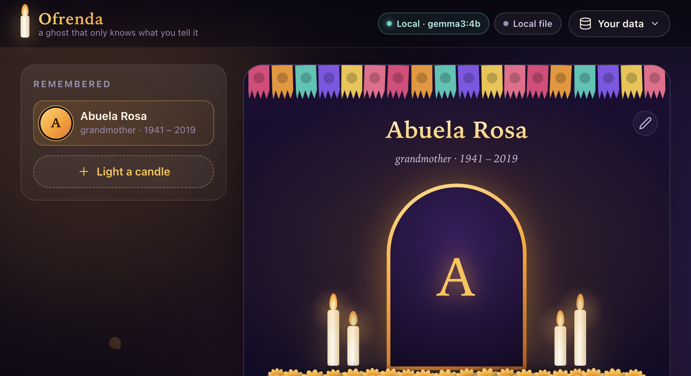
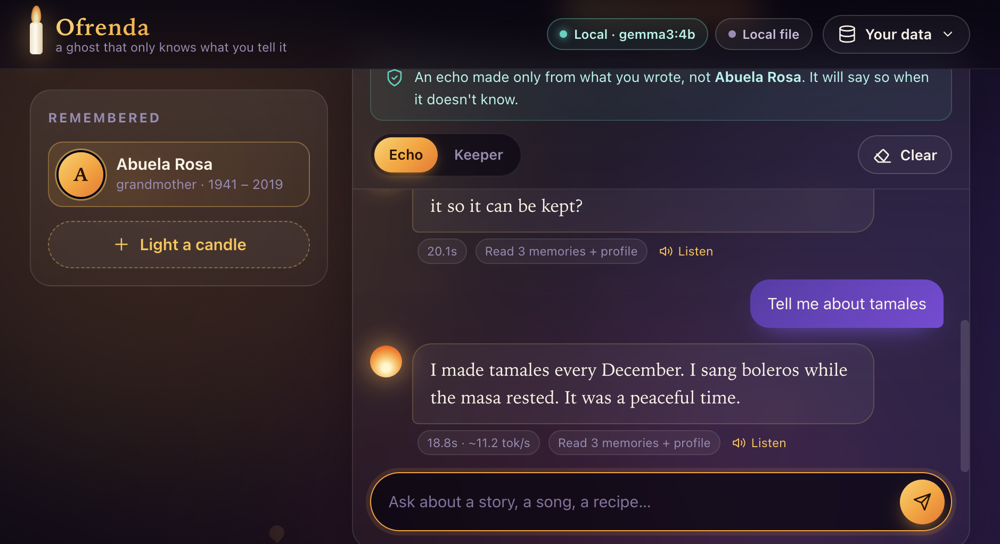

# 🕯 Ofrenda: a ghost that only knows what you tell it

A local-first memory altar for Día de los Muertos. You write down stories about someone you miss. A small **open-weight Gemma model running on your own computer** can then echo those stories back, or write a letter or a *calaverita* for the altar.



The ghost is built around one rule: **it may not invent a memory.** Prompting alone didn't achieve that with a 4B model (see [what I measured](#what-i-measured)), so the rule is enforced in code.



*Top to bottom: a question the memories can't answer ("What was your favorite color?") gets a plain refusal; a question they can answer gets a grounded reply. Both ran on a laptop with `gemma3:4b`.*

## Run it (offline-capable)

```bash
# 1. an open-weight model, locally (Ollama >= 0.6 for Gemma 3)
brew install ollama            # or https://ollama.com/download
ollama serve &
ollama pull gemma3:4b          # ~3.3 GB. gemma3:1b is faster but much less accurate (see below)

# 2. the app
npm install
cp .env.example .env           # optional keys live here; none are required
npm run doctor                 # checks Ollama + any keys you added, tells you what to fix
npm start                      # http://127.0.0.1:3000
```

After the one-time model download, turn Wi-Fi off. Everything keeps working: no CDN, no web fonts, no analytics, and the server binds to loopback only.

```bash
npm test                       # 25 unit tests: retrieval, gate, storage, prompts, security
npm run eval                   # honesty/recall eval against the REAL local model (~2 min)
OFRENDA_MODEL=gemma3:1b npm run eval -- --repeat 3   # swap the model, same harness
```

## How it works

```
 browser ──SSE──▶ server/index.js
                       │
   store.js ◀──────────┤  JSON file | MongoDB Atlas
                       ▼
   retrieve.js   everything that fits in context, most relevant first (BM25)
                       ▼
   Mastra Agent ──OpenAI-compatible──▶ Ollama ──▶ Gemma 3
                       ▼
   gate.js   1. EVIDENCE quote must exist in a memory   (else refuse)
             2. a tiny YES/NO check: is that memory about what was asked? (else refuse)
             3. only then does the reply reach the user
                       ▼
   telemetry.js  local stats always; Sentry spans only if SENTRY_DSN is set
```

### The citation gate

The model must answer in two parts:

```
EVIDENCE: "words copied from ONE memory"   (or NONE)
REPLY: ...
```

Before any text reaches the user, `gate.js` checks the quote against the stored memories, then a second, independent, temperature-0 call checks that the memory is actually about the question. If either check fails, or the model ignores the format, the user gets a fixed refusal and the model's own reply is discarded. A weaker model therefore *fails closed*: it says "nobody has told me that yet" more often, rather than making something up.

This makes displaying a **fabricated quote** impossible. It does **not** guarantee every word of an accepted reply is grounded (see limitations).

### Why BM25 and no vector database?

A family has dozens to a few hundred stories. Almost all of them fit in the model's context, so the ghost is handed everything that fits, ordered by relevance (profile facts, then BM25 hits, then newest-first). Retrieval only decides priority once the corpus outgrows the budget. That keeps it instant, deterministic, dependency-free, and fully offline. It also means a Spanish question can still reach a story written in English, because nothing is filtered out first.

## What I measured

`scripts/eval.mjs` runs 9 hand-written cases (5 answerable, 4 unanswerable, including one in Spanish) against the real local model, and scores two failure modes separately: **recall** (answerable, must use the memory) and **honesty** (unanswerable, must admit it and not assert invented specifics).

| model | mode | runs | recall | honesty | avg reply |
|---|---|---|---|---|---|
| `gemma3:4b` | echo | 27 | 15/15 | 12/12 | ~5.7 s |
| `gemma3:4b` | keeper | 18 | 10/10 | 8/8 | ~7.1 s |
| `gemma3:1b` | echo | 27 | 6/15 | 12/12 | ~2.2 s |

Same code and same eval; only `OFRENDA_MODEL` changed. The 1B model is 2.5× faster and refuses far more often, but it **still did not fail on honesty**.

What went wrong along the way (the eval and unit tests now guard each of these):

- Without the gate, with prompt rules alone, the 4B model answered "what was your favorite color?" with an unrelated memory about marigolds.
- A few-shot example in the prompt **leaked**: a Spanish question was answered with a detail from the example persona. I removed few-shot examples entirely and added a regression test.
- A relevance prompt that said "does this memory directly answer the *question*?" scored 10/14 on my probe set, and wrongly rejected requests like "Tell me about your garden". Rewording to "is this memory about what the user is asking for?" scored 14/14.
- Mastra's `textStream` silently ends empty when the model call fails; the error only appears in `fullStream`. The app uses `fullStream`.

**Caveats:** I tuned prompts against these same cases, so this is a regression harness, not a held-out benchmark; 9 cases is small; and the scorers are regexes. In the browser on an 8 GB MacBook with other apps open, time to first word was **10 to 12 s**, about 3 s of which is the relevance check. Token counts are estimates (~4 chars/token) because Ollama's OpenAI-compatible stream reports no usage.

## Optional partner integrations (all off by default)

Copy `.env.example` to `.env` and fill in only what you want, then run `npm run doctor`. Step-by-step key instructions are in [SETUP.md](SETUP.md).

| Env var | Partner | What it adds | What leaves your machine | Verified? |
|---|---|---|---|---|
| *(always)* | **Gemma** (open weights) via Ollama | Every reply, letter and poem | nothing | ✅ ran end to end |
| *(always)* | **Mastra** | Agent framework wrapping the model | nothing | ✅ ran end to end |
| `MONGODB_URI` | **MongoDB Atlas** | Altars stored in your Atlas cluster | the altar data, to your cluster | ⚠️ only the *fallback* path is tested (unreachable URI → local file). Not run against a real cluster. |
| `SENTRY_DSN` | **Sentry** agent tracing | `gen_ai.invoke_agent` spans: model, latency, token estimates, gate result | timings and counts only; never prompts, memories or replies | ⚠️ initializes and a gated run completes; I could not confirm events arrive without a live DSN. |
| `ELEVENLABS_API_KEY` | **ElevenLabs** | 🔊 narration; 🎙 *record a story* via Scribe transcription | the text or audio you choose to speak or record (UI shows a ☁ badge) | ❌ written against the API docs, never run with a real key |
| `render.yaml` | **Render** | Blueprint: PIN-protected web app + *private* Ollama service | n/a | ❌ not deployed |

Partners I looked at and left out (Temporal, Auth0, Tiger Data, etc.) would not have made this project better, so I didn't bolt them on.

### Deploying (optional, and not the point)

The point of Ofrenda is that you don't have to. For a shared family altar, set `OFRENDA_PIN` (signed cookie, rate-limited login) and see `render.yaml` and the step-by-step guide in [SETUP.md](SETUP.md#part-3-deploy-to-render-optional). CPU inference on Render is slow; use `gemma3:1b`, or point `OLLAMA_BASE_URL` at a GPU host. The `Dockerfile`s are untested.

## Privacy & safety choices

- Binds to `127.0.0.1` by default. Host-header and Origin checks defend against DNS-rebinding and cross-site writes to your local server (unit-tested).
- Photos are downscaled in the browser and stored only in your altar. Stories render via `textContent`, so memories can't inject HTML.
- *Download everything* exports plain JSON. *Erase everything* needs a typed confirmation.
- Memories are passed to the model as quoted data, never as instructions. The prompt tells the model to point someone in distress toward trusted people or a crisis line.
- The ghost always says it is *an echo made of written memories*, not the person, and an always-visible banner repeats it.

## Limitations (honest list)

- The gate checks the **quote**, not every word of the reply. On `gemma3:1b` one accepted reply added "a warm smile and a good conversation" that no memory contains.
- Letters and poems are *creative* output and are not gated. Tighter prompts cut invented details a lot, but a 4B model still adds small flourishes ("you loved them so much") and its Spanish is imperfect (it left "marigolds" in English and coined "marigolias"). Read before you read aloud.
- A small model can still pick a memory that is real but subtly wrong. The relevance check lowers this; it is not a proof.
- Lexical (BM25) ranking can't bridge languages or synonyms; "everything that fits" covers that for typical altars, but a huge corpus would need embeddings.
- Memories are not encrypted at rest. Use full-disk encryption (FileVault) on shared machines.
- Replies take seconds, not milliseconds, on modest hardware.
